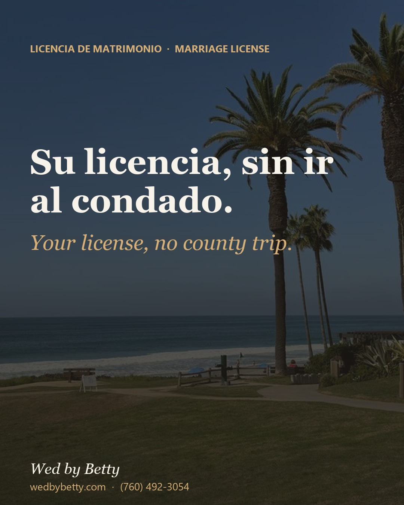
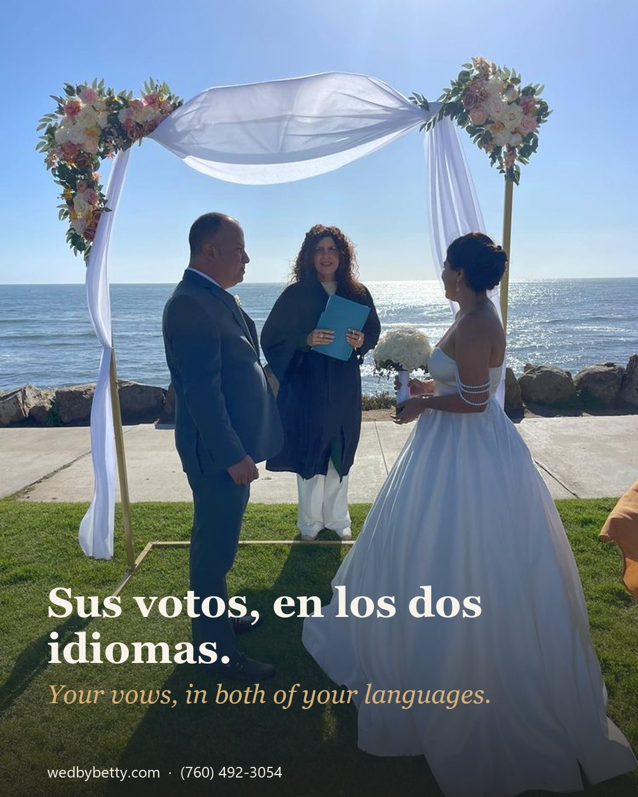
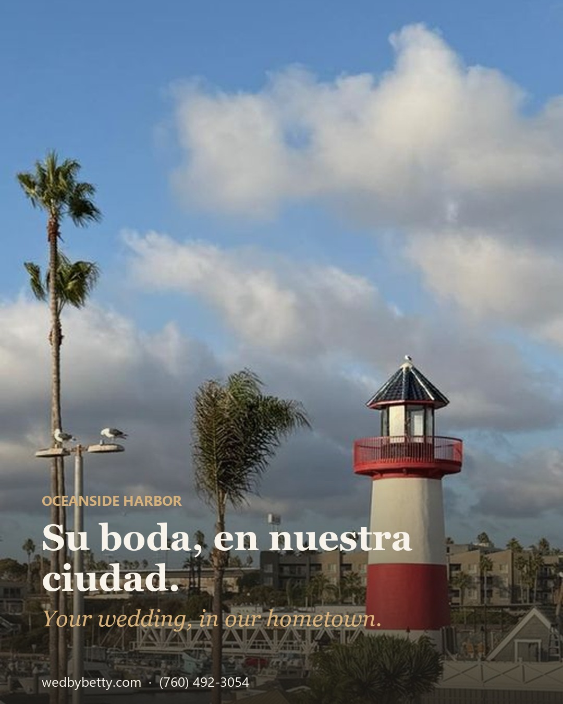
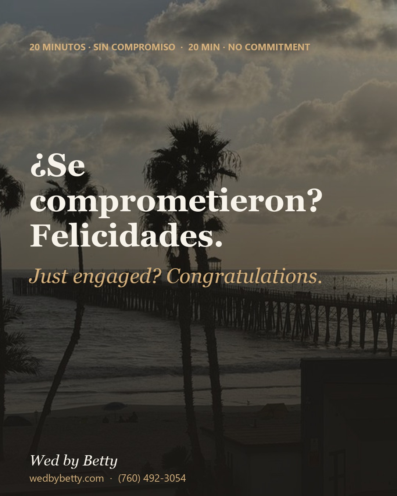

# Review sheet — 2026-W48  (posts at Pacific Time)

Reply per post: **APPROVE**, **CHANGE: <what>**, or **REJECT**. Nothing is scheduled until a post is approved.


---

## Post 1 · Tue 2026-11-24 12:00 PM · License & legal made easy  — status: `needs_review`



**Goal:** Educate couples on the confidential license; drive saves/shares and calls  
**Format:** Single image 1080x1350 (could become a 4-slide carousel)  
**Image source:** assets/photos/delmar-bluff-palms.jpg (own photo, scenery) + text overlay  
**Consent/notes:** No people. Original photo is 900x675; use a higher-res original if available.

**Caption (Spanish first, then English):**

```
¿Sabían que pueden sacar su licencia de matrimonio sin ir al condado?

Betty es una notary public autorizada por el condado, así que ella misma la emite: en la consulta o el mismo día de la boda. Nada de cita en el centro ni segundo viaje. Ya firmada, Betty la registra con el condado.

Solo necesitan una identificación oficial con foto cada uno, estar los dos presentes y vivir juntos como pareja.

Guárdenlo para cuando lo necesiten, o llámennos al (760) 492-3054.

—————
🇺🇸 Good news if you were dreading a trip downtown: you don't have to make one.

Betty is an authorized notary public, so she issues your confidential marriage license herself, either at your consult or on the wedding day. She files it with the county after you're married.

All you need is a government photo ID each, both of you there, and already living together as a couple.

Save this for later, or call (760) 492-3054. More at wedbybetty.com.

🔗 wedbybetty.com
📍 Oceanside · San Diego County
#LicenciaDeMatrimonio #BodaEnSanDiego #OficianteDeBodas #MatrimonioCivil #BodaBilingue #MarriageLicense #SanDiegoWedding #WeddingOfficiant #OceansideWedding #NorthCountySD
```

**Facebook only, add at the end:** `🔗 https://wedbybetty.com`

**Alt text ES:** Palmeras y el océano en un parque junto a la playa de Del Mar, con el texto «Su licencia, sin ir al condado».  
**Alt text EN:** Palm trees and the ocean at a beachside park in Del Mar, with the text “Your license, no county trip.”

**Facts used:** Betty is an authorized notary public and issues the confidential license herself (consult or wedding day); No county appointment; Betty files with the county afterward; Requirements: photo ID each, both present, living together

**⚠️ Flags for the approver:** Confirm the wording about 'confidential license' and that 'living together as spouses' is the right plain-language phrase. No fee or price mentioned on purpose.


---

## Post 2 · Fri 2026-11-27 7:30 PM · Ceremony & experience  — status: `needs_review`



**Goal:** Show the bilingual ceremony; get comments (engagement) and inquiries  
**Format:** Single image 1080x1350  
**Image source:** assets/photos/betty-couple-ocean-1.jpg (own photo of a real ceremony) + text overlay  
**Consent/notes:** Real couple. Consent for social media unknown. DO NOT PUBLISH until Betty confirms the couple agreed. Photo is 750x1000: replace with original.

**Caption (Spanish first, then English):**

```
Nadie se queda sentado en una boda que no entiende.

Betty oficia en español, en inglés o en los dos, y escribe los dos idiomas juntos en el guion, no los traduce al final. Cada pareja lo arma a su manera: línea por línea, un idioma para los votos y otro para las lecturas, o todo en uno solo.

¿Cómo lo harían ustedes? Cuéntennos en los comentarios. Para hablar con Betty: (760) 492-3054.

—————
🇺🇸 When your guests speak different languages, the ceremony shouldn't leave anyone out.

Betty officiates in English, Spanish or both, and writes the languages into the script together. Some couples go line by line, some split it by moment (vows in one language, readings in the other), and some stay in a single language the whole time.

Which would you choose? Tell us below. To talk with Betty, call (760) 492-3054.

📍 San Diego County
#CeremoniaBilingue #BodaBilingue #OficianteDeBodas #BodaEnSanDiego #BodaEnLaPlaya #BilingualWedding #WeddingOfficiant #BeachWedding #SanDiegoWedding #NorthCountySD
```

**Facebook only, add at the end:** `🔗 https://wedbybetty.com`

**Alt text ES:** Betty oficia una ceremonia en la playa bajo un arco de flores blancas y rosas, con la pareja frente a frente y el océano de fondo.  
**Alt text EN:** Betty officiates a beach ceremony under an arch of white and pink flowers, the couple facing each other with the ocean behind them.

**Facts used:** Ceremonies in English, Spanish, or both; Three bilingual formats: line by line, split by moment, one language

**⚠️ Flags for the approver:** BLOCKER: confirm the couple in this photo agreed to social-media use. Thursday 11/26 is Thanksgiving, so this slot moved to Friday evening.


---

## Post 3 · Sat 2026-11-28 10:00 AM · Locations  — status: `needs_review`



**Goal:** Local inspiration + local SEO; show Oceanside is home base (no travel fee)  
**Format:** Single image 1080x1350  
**Image source:** assets/photos/oceanside-harbor.jpg (own photo, scenery) + text overlay  
**Consent/notes:** No people. Original is 500x747 (low-res, looks soft at 1080). Replace with higher-res original.

**Caption (Spanish first, then English):**

```
Oceanside es la ciudad de Betty.

Aquí no hay cargo por viaje, y los lugares sobran: el puerto, el muelle, Buccaneer Beach, Heritage Park, la laguna de Buena Vista. Si piensan llevar sillas, arco o música, muchas veces hay que pedir permiso a la ciudad, así que háganlo con tiempo.

Cuéntennos qué lugar les gusta y Betty les ayuda con el resto: (760) 492-3054 🌴

—————
🇺🇸 Oceanside is Betty's hometown, so there's no travel fee here.

Pick your spot: the harbor, the pier, Buccaneer Beach, Heritage Park or the Buena Vista Lagoon bluff. If you want chairs, an arch or music, ask the city for a permit early.

Tell us where you're thinking and Betty will help you sort out the rest. Call or text (760) 492-3054.

📍 Oceanside Harbor
#BodasOceanside #BodaEnLaPlaya #BodaEnSanDiego #OficianteDeBodas #BodaIntima #OceansideWedding #OceansideHarbor #BeachWedding #WeddingOfficiant #NorthCountySD
```

**Facebook only, add at the end:** `🔗 https://wedbybetty.com`

**Alt text ES:** El faro rojo y blanco del puerto de Oceanside entre palmeras, con nubes en el cielo.  
**Alt text EN:** The red-and-white lighthouse at Oceanside Harbor among palm trees under a cloudy sky.

**Facts used:** Oceanside is Betty's home town; no travel fee; Spots: pier amphitheatre and beach, Buccaneer Beach Park, harbor beach lawn, Heritage Park garden, Buena Vista Lagoon bluff; Reserved areas, chairs, arches, amplified music usually need city permits

**⚠️ Flags for the approver:** Confirm 'no travel fee in Oceanside' is still true. Each city's permit rules differ; the tip is kept general on purpose.


---

## Post 4 · Sun 2026-11-29 6:00 PM · Offer & CTA (engagement season)  — status: `needs_review`



**Goal:** Catch newly engaged couples over the holiday weekend; drive calls  
**Format:** Single image 1080x1350  
**Image source:** assets/photos/oceanside-pier.jpg (own photo, scenery) + text overlay  
**Consent/notes:** No identifiable people (tiny silhouettes only).

**Caption (Spanish first, then English):**

```
Si alguien dijo que sí en estas fiestas, ya saben a quién llamar.

Cuando quieran, hablamos 20 minutos: la fecha, el lugar, los idiomas y cómo van con los papeles. Sin compromiso. Betty se encarga de la ceremonia y de la licencia, y va a donde ustedes estén.

Llamen o escriban al (760) 492-3054, o entren al link en la bio. 💍

—————
🇺🇸 Said yes this holiday season? Congratulations.

Whenever you're ready, we can talk for 20 minutes about the date, the place, the languages and the paperwork. No commitment. Betty handles the ceremony and the license, and she'll come to you.

Call or text (760) 492-3054, or use the link in our bio.

📍 Oceanside · San Diego County
#BodaEnSanDiego #OficianteDeBodas #NoviasSanDiego #BodaBilingue #MatrimonioCivil #SanDiegoWedding #WeddingOfficiant #OceansideWedding #BilingualWedding
```

**Facebook only, add at the end:** `🔗 https://wedbybetty.com`

**Alt text ES:** El muelle de Oceanside al atardecer, con palmeras y el texto «¿Se comprometieron? Felicidades».  
**Alt text EN:** Oceanside Pier at sunset with palm trees and the text “Just engaged? Congratulations.”

**Facts used:** Free 20-minute call, no commitment (date, place, languages, paperwork); Betty handles ceremony and license and travels to the couple; Phone (760) 492-3054

**⚠️ Flags for the approver:** The site says the online scheduler is 'being set up'; the post points to phone/text and 'link in bio' (make sure the bio link works). Hashtag #Engaged is generic; fine to drop.
